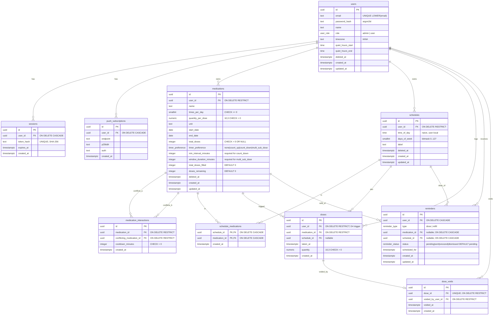

# MedMinder — Entity-Relationship Diagram

The schema below is the v1 data model committed in Phase 1, plus the
`dose_voids` table added in Phase 4. Every table, column, and
relationship matches the committed Alembic migrations
(`backend/alembic/versions/0001_phase_1_baseline.py` and
`backend/alembic/versions/XXXX_add_dose_voids_table.py`) and the
SQLAlchemy models under `backend/src/medminder/db/models/`.

For the rationale behind individual choices, see the **Decisions
(D1–D12)** table in
`specs/2026-04-29-phase-1-data-model/requirements.md`. Highlights
that don't render cleanly in Mermaid:

- **D2** — `schedules.days_of_week` is a 7-bit bitmask
  (`Mon=bit 0 … Sun=bit 6`), `CHECK BETWEEN 0 AND 127`.
- **D3** — `reminders` carries two nullable FKs and a CHECK ensuring
  exactly one is set per `type` value.
- **D4** — `doses.user_id` is denormalized; a Postgres trigger
  enforces `doses.user_id == medications.user_id`.
- **D5** — `medication_interactions` is symmetric in semantics; a
  unique index on the unordered pair (`LEAST/GREATEST`) prevents
  duplicates.
- **D6** — `users`, `medications`, `schedules` are soft-deleted via
  `deleted_at`; `doses` are append-only.
- **D6 (Phase 4)** — un-take is recorded as a compensating row in
  `dose_voids` with `UNIQUE(dose_id)`. Readers (Today view,
  adherence) `LEFT JOIN dose_voids` and ignore doses with a matching
  void. `doses` rows themselves are never updated or deleted.
- **D8** — `users.email` uniqueness is enforced via a functional
  unique index on `LOWER(email)`.
- **D10** — `push_subscriptions` has UNIQUE `(user_id, endpoint)`.

