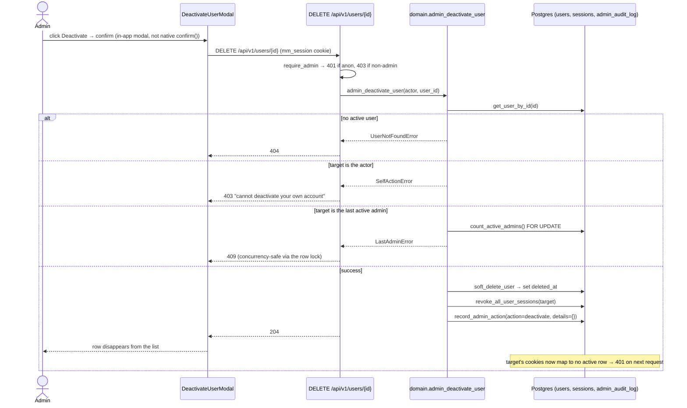

# Sequence — admin deactivates a user (`DELETE /api/v1/users/{id}`)

How an admin deactivates another user in-app: the `require_admin` gate authorizes
the caller, the domain resolves the target by id, applies the self / last-admin
guards, soft-deletes the row and **revokes all of the target's sessions**, and
appends one audit row — all in the same request transaction (ADR-0014 / feature
009).

