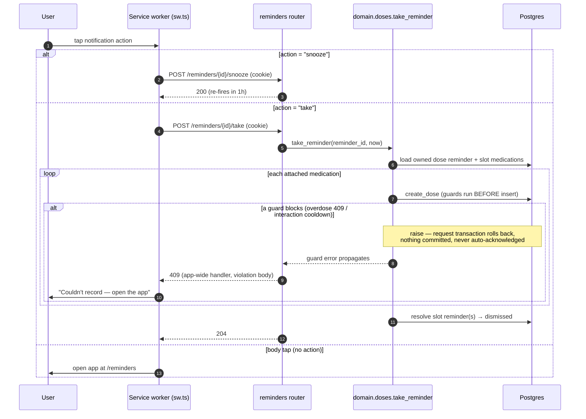

# Notification action flow (sequence)

What happens when a user taps a **Snooze** or **Mark taken** action button on a dose-reminder
notification (Phase 8, ADR-0015). The actions are handled in the service worker and act on the
server via reminder-id-keyed endpoints; "Mark taken" records a dose per attached medication
and is atomic — any overdose/interaction guard blocks the whole take and the worker shows a
fail-safe "open the app" notification.

