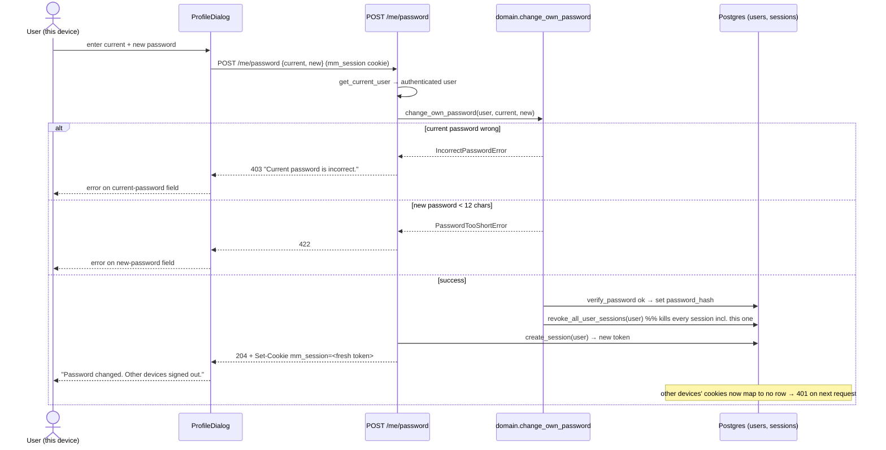

# Sequence — self-service password change (`POST /me/password`)

How a signed-in user changes their own password: the current password is verified,
the new hash is stored, **all** of the user's sessions are revoked, and a fresh
session is issued for the current device so it stays signed in while other devices
are logged out (ADR-0011 / feature 007).

