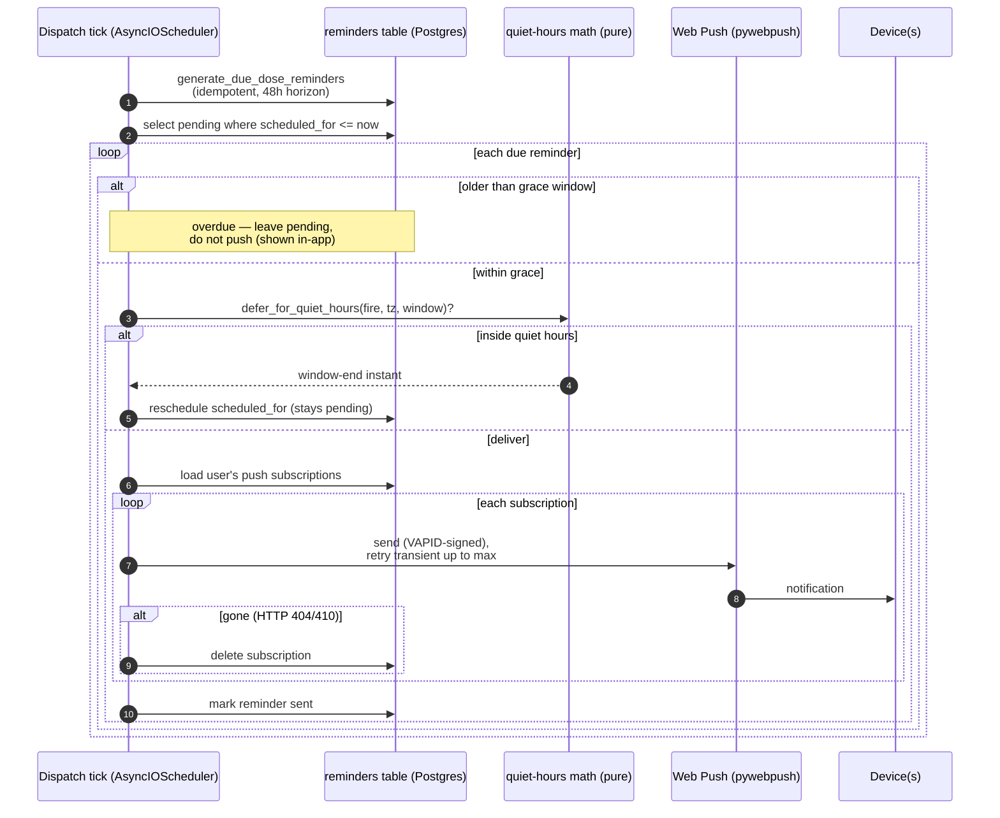

# Reminder dispatch flow (sequence)

What the in-process APScheduler "dispatch tick" does each interval (Phase 7,
ADR-0002). Durable state is the `reminders` table; the scheduler only holds
the recurring tick in memory.

