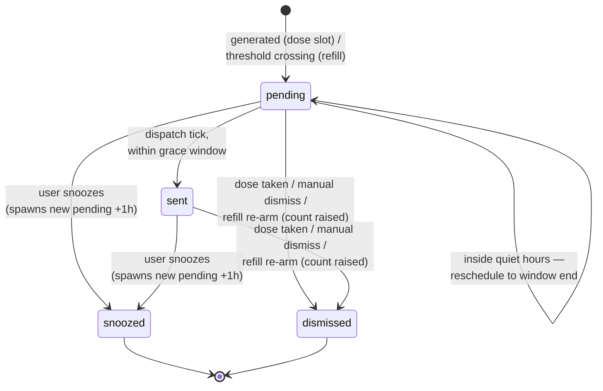

# Reminder lifecycle (state machine)

The `reminders.status` lifecycle for both dose and refill reminders (Phase 7).
`pending` is the only live state the dispatch tick acts on; `snoozed` and
`dismissed` are terminal. Quiet-hours deferral and the overdue case are
*reschedule / no-op* transitions that keep a row `pending`.

Notes:

- **Snooze** marks the original `snoozed` (terminal) and creates a fresh
  `pending` reminder one hour out. For a *refill* reminder the single open row
  is moved forward instead (the `uq_reminders_open_refill` one-open-per-med
  invariant), so it stays `pending`.
- **Overdue**: a due reminder older than the grace window is never pushed but
  remains `pending` (visible in-app as overdue) until taken or dismissed.
- **Quiet hours**: deferral rewrites `scheduled_for` to the window end and
  leaves the row `pending`; a later tick delivers it.
