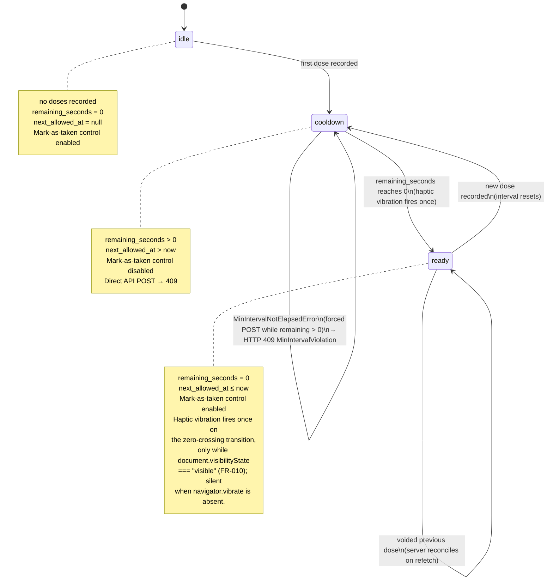

# Timer state diagram: count_down

The `count_down` mode reports remaining time until
`last_dose_at + min_interval_minutes`, clamped at zero. The server-side
guard in `domain/doses.create_dose` enforces the interval regardless of
whether the call came from the FE (FR-005 / FR-006); the client UI is
advisory and ticks locally between server refetches.

## Invariants

1. `remaining_seconds == 0` iff `next_allowed_at is None` or `next_allowed_at ≤ now`.
2. `remaining_seconds ≤ min_interval_seconds` always; `max(0, …)` is the
   only clamp on the server (`domain/timers.compute_timer_state`).
3. The server rejects `POST /api/doses` while `remaining_seconds > 0` for
   a `count_down` med — `MinIntervalNotElapsedError` raised in
   `domain/doses.create_dose`, mapped by the global handler in `app.py`
   to HTTP 409 with the `MinIntervalViolation` body.
4. Voiding the most recent dose collapses the cooldown — the next
   non-voided dose surfaces as `last_dose_at` and the timer recomputes.
5. Haptic feedback fires **once** per zero-crossing, gated on
   foreground visibility. iOS Safari has no Vibration API; degrade
   silently.
