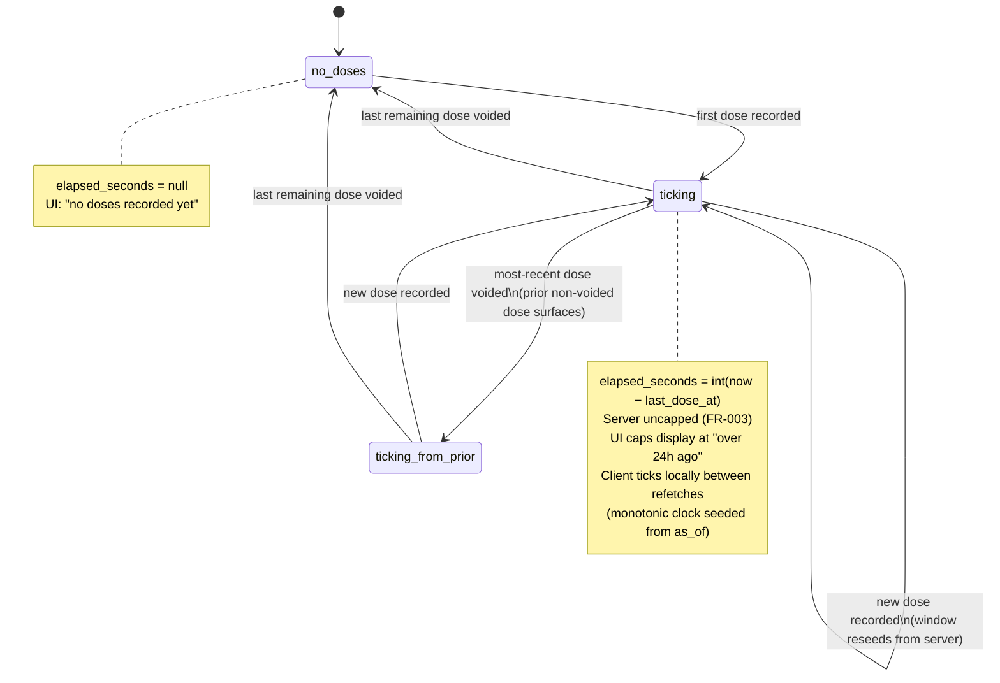

# Timer state diagram: count_up

The `count_up` mode reports time since the most-recent **non-voided** dose.
Voided doses (Phase 4 `dose_voids` rows) are filtered at the SQL boundary
(`load_non_voided_history_for_meds`); the state machine sees only the
filtered history.

## Invariants

1. `last_dose_at` always refers to the **newest non-voided** dose.
2. `elapsed_seconds` on the wire is **never capped** — Phase 6 drug-interaction
   logic depends on full precision (FR-003).
3. The display cap at "over 24h ago" is a frontend-only concern
   (`frontend/src/lib/timers.ts::formatElapsed`).
4. Voiding the most recent dose collapses to `ticking_from_prior` (or to
   `no_doses` if no other non-voided dose remains).
