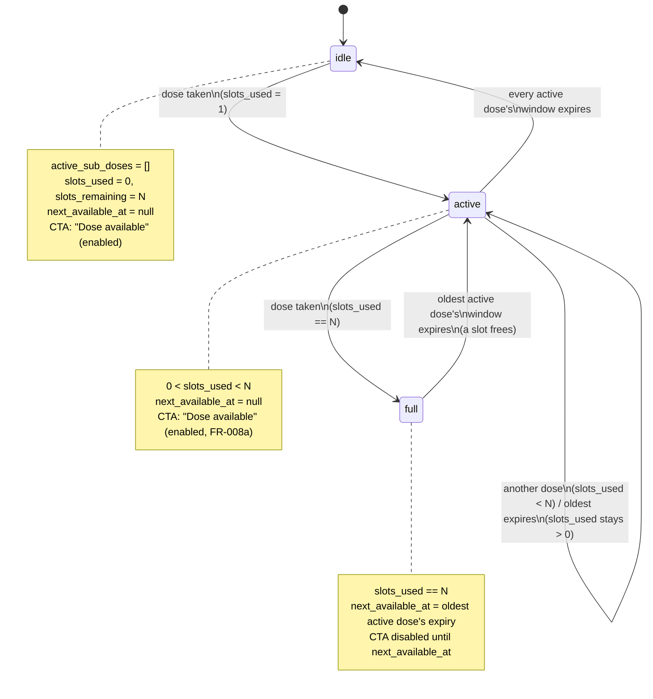

# Timer state diagram: multi_sub_dose

The `multi_sub_dose` mode lets a medication be taken repeatedly, but
bounds **concurrency**: each dose opens its own rolling
`window_duration_minutes` window, and at most `times_per_day` doses
(the "max at a time" cap, `N`) may overlap. Equivalently, no more than
`N` non-voided doses may fall in any rolling `window_duration` period.
The cap exists solely to prevent overdose — no missed-dose record is
persisted (FR-008). An optional `max_doses_per_day` adds a separate
hard daily ceiling. See **ADR-0010** for why this replaced the original
single-tiled-window model.

## Rolling-window invariants (data-model.md §"Window invariants")

1. Each non-voided dose is "active" for `window_duration_minutes` after
   its `taken_at`.
2. At a time `t`, the active doses are those taken in
   `(t - window_duration, t]`.
3. `slots_used = |active doses at t|`; `slots_remaining = max(0, N -
   slots_used)`.
4. The mark-as-taken control is disabled (and a prospective dose 409s
   with `window_full`) iff `slots_used ≥ N`.
5. `next_available_at = (oldest active dose).taken_at +
   window_duration` when at capacity, else `null` — the moment the
   oldest active dose ages out and frees a slot.
6. The med's timer is "running" (and surfaces on `/today` when
   unscheduled) iff `slots_used > 0`.

Voided doses (Phase 4 `dose_voids`) are filtered at the SQL boundary
(`load_non_voided_history_for_meds`) before the state machine runs, so
the algorithm never sees them. The single source of truth for the
active-set arithmetic is `domain.timers._active_at`, shared by
`compute_timer_state` and the `multi_sub_dose_window_full` guard.
