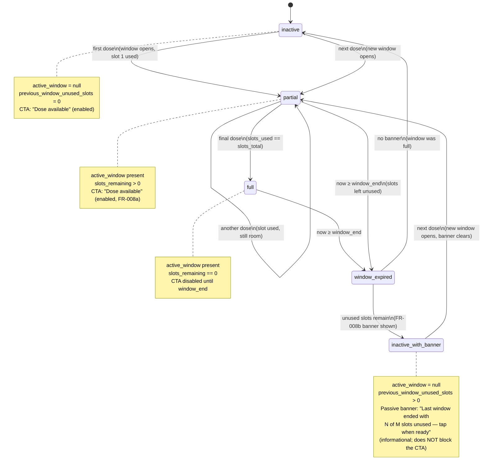

# Timer state diagram: multi_sub_dose

The `multi_sub_dose` mode lets a medication be taken up to
`times_per_day` times inside a rolling `window_duration_minutes`
window. A window is opened by the first dose taken while no window is
active; subsequent doses inside that window fill its slots. The window
exists solely to prevent overdose — no missed-slot record is persisted
when it expires with slots unused (FR-008).

## Window invariants (data-model.md §"Window invariants")

1. A window has fixed length `window_duration_minutes`.
2. `window_start = first_dose.taken_at` for the dose that opened the
   window. A dose opens a window iff, at its `taken_at`, no window was
   active.
3. A window is active iff `window_start ≤ now < window_end` AND there
   exists at least one non-voided dose with `taken_at ∈ [window_start,
   window_end)`.
4. `slots_used = |{ d ∈ non_voided_doses : window_start ≤ d.taken_at <
   window_end }|`.
5. The mark-as-taken control is disabled iff a window is active AND
   `slots_used ≥ slots_total`.
6. `previous_window_unused_slots` is computed from the most-recently
   expired window ONLY IF no new window has been started since that one
   expired. A new dose creates a new window AND clears the banner
   simultaneously.

Voided doses (Phase 4 `dose_voids`) are filtered at the SQL boundary
(`load_non_voided_history_for_meds`) before the state machine runs, so
the algorithm never sees them.
